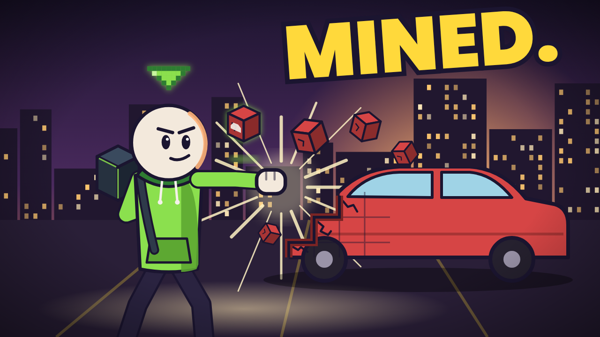

# GAMERULE

**Real life just got game rules.** A YouTube channel of animated What If stories: every episode, someone types a
new `/gamerule` into reality and you have to live with it, with the real science of what would actually happen.

Goal: 10,000 subscribers. Claude runs the channel (topics, scripts, science, animation, packaging, decisions); you
run the account (uploads, comments, numbers) and keep the game details honest.

## Status (28 Oct 2026)

- [x] Market research: what's working, what isn't, and why → `research/2026-10-28-market-scan.md`
- [x] Channel identity, cast, look, rules → `BIBLE.md`
- [x] Plan to 10K with targets and decision rules → `PLAN.md`
- [x] Episode 1 written: script, checked science, Shorts, upload package → `episodes/01-mine-anything/`
- [x] Concept art: profile picture, banner, cast, thumbnail mockup → `art/`
- [ ] **You:** create the channel (checklist in `PLAN.md`)
- [ ] **You:** OK installing the animation studio (a free, MIT-licensed Claude Code skill built on Remotion)
- [ ] **You:** ElevenLabs Starter ($6/mo) and its API key in the environment as `ELEVENLABS_API_KEY`
- [ ] Claude: build the studio, style the rig as our cast, storyboard and animate episode 1
- [ ] First upload, on a Friday

## Files

| File | What |
|---|---|
| `BIBLE.md` | Who we are: name, the `/gamerule` hook, the Admin, the cast, the look, title and thumbnail rules, what we never do |
| `PLAN.md` | How we get to 10K: cadence, phases, what we measure and what we do about it, launch checklist, costs |
| `WEEKLY.md` | The weekly loop: who does what, how to start a session, how to send numbers, the upload checklist |
| `BACKLOG.md` | Topics, each checked against YouTube, plus the list of premises other channels already own |
| `episodes/` | One folder per episode |
| `research/` | The evidence behind the decisions |
| `art/` | Channel art; `node channel/art/build.cjs` re-renders it |
| `CLAUDE.md` | Notes for Claude, so every session picks up where the last one stopped |
| `studio/`, `.claude/skills/what-if-animation/` | The animation pipeline: [what-if-animation](https://github.com/kelano86/what-if-animation) by FreshStack, MIT licence (see `studio/LICENSE`). We restyle it as our own cast and look. |

## Starting a session

Say `GAMERULE: weekly check-in` or `GAMERULE: make episode 2` in a Claude Code session on this repo.
